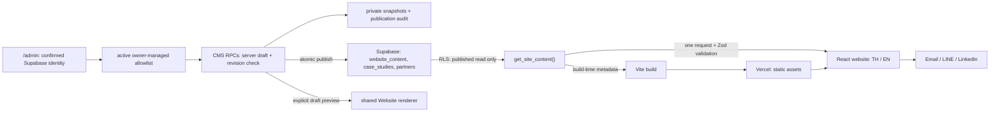

# Project map

Updated: 2026-10-16. Distinguish intended behavior below from verified deployment
state in [RELEASE.md](RELEASE.md).
The Thai operator guide and complete field groups are in [CMS.md](CMS.md).

## Architecture

The public site has no content-write path, member login or lead storage. CMS is
at `/admin`. Signing in does not itself authorize editing: every privileged RPC
checks the confirmed `auth.users` identity against the active `cms_admins`
allowlist. No service key, database password or management token reaches the browser.

## Ownership map

| Location | Owner / purpose |
| --- | --- |
| `src/App.tsx` | Public load/error states and shared `Website` renderer for live content and draft preview |
| `src/content.ts` | Data contract, validation and published-content fetch |
| `src/cms/` | CMS auth client, section navigation, editor fields and draft/publication workflow |
| `src/components/` | Neural X, accessible native dialog, mobile card rail |
| `src/components/HeroMedia.tsx` | CMS hero video/poster rendering, reduced-motion fallback and visibility-aware playback |
| `src/components/PartnerTicker.tsx` | CMS-driven logo sequence, constant-speed motion, pause and keyboard/static access |
| `src/styles.css` | DeepX brand roles and responsive rendering |
| `public/images/` | Licensed initial image assets, addressed by CMS URLs |
| `public/videos/` | Optimized owner-supplied MP4 renditions; provenance in `docs/ASSETS.md` |
| `public/favicon.svg` | Vector brand adaptation from supplied reference |
| `vite.config.ts` | Build-time CMS metadata and explicitly local-only fixture middleware |
| `scripts/seo.ts`, `tests/seo.test.ts` | CMS-derived social/structured metadata, canonical identity and SEO safety checks |
| `public/robots.txt`, `public/sitemap.xml`, `docs/SEO.md` | Crawler discovery and Search Console workflow; `/admin` noindex comes from Vercel headers |
| `supabase/migrations/` | Append-only database schema/policy/editorial initialization |
| `supabase/content/initial-content.json` | Historical initial editorial data and local review fixture |
| `supabase/tests/` | Transactional public/CMS access and publication checks; requires a trusted connection |
| `tests/content.test.ts` | Published-content validation and unsafe-link regression checks |
| `src/cms/model.test.ts` | Editor data helpers and supported/reserved field checks |
| `docs/references/` | Original user-supplied mockups, not shipped to public web |
| `artifacts/` | Ignored screenshots/verification notes |
| `dist/` | Generated deploy output, never hand-edit or commit |

No framework existed in the initial GitHub repository, which contained only a
two-line README. React + TypeScript + Vite is the initial implementation decision,
chosen for a compact presentation website with a separate content database.

## Content ownership and CMS

`website_content` stores one JSON document per named section. All editorial text,
navigation labels/destinations, contact details, industry media URLs/alt/crops,
hero video/poster URLs, service descriptions, dialogs and UI translations come
from these records.

Keys: `site`, `hero`, `capabilities`, `industries`, `process`, `applications`,
`caseStudies`, `why`, `ecosystem`, `partners`, `contact`, `insights`, `privacy`, `ui`.
The contract in `src/content.ts` is the canonical field/type definition.

Most text uses `{ "th": "...", "en": "..." }`. Icons use a constrained registry
in `App.tsx`; raw HTML is never rendered. Images support same-site `/images/`
paths or HTTPS; hero video supports `/videos/*.mp4` or HTTPS. Links support
HTTPS, mailto and internal anchors.

`case_studies` contains verified real work with bilingual title/summary/sector/
body and metrics. It starts empty. Until real records are published, the page
uses the CMS-owned illustrative applications section with an explicit note.

`partners` contains name, logo, website and publication state. It starts empty.
The ecosystem section describes collaboration categories, not claimed partnerships.

Public tables have draft/published status and an update timestamp. `anon` and
`authenticated` have SELECT only, filtered by RLS to published rows. The public
RPC is SECURITY INVOKER. CMS tables have no direct browser-role grants.

`cms_workspace` holds one private server draft containing the complete public
content shape. `cms_save_draft` validates the document and expected revision,
then writes an immutable snapshot to `cms_revisions`. `cms_publish` checks the
revision again and applies all public sections and records atomically. It records
the authenticated actor in `cms_publications`. Removed records become unpublished;
they are not erased. First-admin allowlisting is a trusted operator action outside
the repository and CMS UI. The user's personal admin email is not source data.

Optional contact channels, industry images and hero video/poster accept explicit empty values.
Clearing them removes the corresponding public link/image after publication,
without restoring seed content. Stable IDs are not editable; case-study slugs
are separate from identity. Reserved schema fields without public consumers
must not be presented as effective editing controls. See the CMS field map.

### Media boundary

Initial images live in `public/images/`, with prepared video in `public/videos/`.
CMS image uploads use `cms-media`: JPEG, PNG or WebP, maximum 5 MiB per file,
including hero posters. MP4 uploads use a separate `cms-video` bucket, maximum
30 MiB, added by migration `20261016090700_hero_video.sql`. Both require an
allowlisted administrator. URLs are public immediately, including when the
content reference is still a draft; never upload private files.
Each upload gets a fresh object path. Replacing/clearing a field does not overwrite
or delete the old object. Industry alt text and focal position belong to that usage.
Full asset search, deletion, private storage and shared rights metadata are deferred.

`hero.videoUrl` and `hero.videoPoster` are optional, independently clearable CMS
fields. `HeroMedia` fills the desktop/tablet hero background with `object-fit: cover`.
At widths up to 600px, the same media remains an absolute background inside the
banner, behind the copy/actions. Its 16:9 frame is 170% of the viewport width,
centered horizontally at 50% of the banner height. The mobile hero follows its
content height, with a 33px gap between actions and the expertise strip. This crops the empty sides
while keeping the central animated mark and wordmark inside the viewport.
Gradient masking blends its edges into the background. Desktop background
gradients preserve text contrast. Playback is automatic,
muted and looping without controls; it pauses
offscreen or in hidden tabs. Reduced motion shows the poster/static fallback,
and absent video restores the original Neural X and its CMS caption. The renderer
uses one video URL at all viewport sizes; the prepared mobile rendition is an
optional editorial choice, not an automatically selected source.

On mobile (up to 640px), the ecosystem uses `PartnerTicker` with the published
partner order, names, URLs and light/dark surfaces. Desktop/tablet retain the
existing `Rail` renderer and original grid. Mobile moves left-to-right at 32px/s; duration is measured
from one complete logo sequence. A duplicate visual sequence is hidden from
assistive technology and the tab order. The owner requested no visible playback
control. Pointer hover stops motion. Keyboard focus exposes a single stable, horizontally scrollable set of
links; reduced motion shows a wrapping static set. Offscreen/hidden tabs pause.
Partner content and the region label remain CMS-owned.

## Routes and interactions

One page at `/`; anchors `#home`, `#capabilities`, `#industries`, `#process`,
`#applications`, `#about`, `#ecosystem`, `#contact`. Header/footer navigation
uses CMS links. Insights and privacy are informational dialogs, not separate routes.
CMS is reached directly at `/admin`; it has no public member-account features.

Dialogs use native `<dialog>` for focus containment, Escape and inert background.
Closing restores the trigger's focus. Opening locks body scrolling. Cards open
details, with a path to contact. Contact links open email/LINE/LinkedIn; they do
not automatically send any message. There is no false submitted/success state.

Language is stored locally in `deepx.locale`, with the CMS default used for a
new visitor. Storage failure does not block browsing. Motion respects reduced
motion; mobile has a sticky CTA outside hero/contact and horizontal content rails.

## Content availability

The runtime makes one RPC request with a 10-second timeout and validates the
entire public contract. On error it shows a retry screen; it does not silently
substitute initial content. Only technical loading/error messages and layout
semantics are local. All marketing content is remote.
Admin operational copy, validation/error messages, layout and permissions are
also code-owned. A draft preview uses the shared renderer with the current editor
document and does not publish it. An already open public page is not a realtime
subscription; reload it to read newly published content.

Production build also requires valid published data for SEO metadata. Metadata
is a build-time snapshot; body content refreshes on each page load. CMS changes
to SEO title/description need a rebuild/deploy. The CMS does not trigger a deploy
automatically. Changing the browser title after JavaScript loads does not prove
crawler freshness. Future SSR may eliminate that difference.

The fixture middleware exists only in development with
`VITE_LOCAL_CONTENT_PREVIEW=1`. Production builds fail if that flag is enabled.
It is for review/testing, never a substitute for applying migrations.

## Commands and environment

| Command | Purpose |
| --- | --- |
| `npm ci` | Install exact lockfile dependencies |
| `npm run dev` | Read real published Supabase data on port 5173 |
| `VITE_LOCAL_CONTENT_PREVIEW=1 npm run dev` | Explicit local fixture review |
| `npm run typecheck` | TypeScript contract check |
| `npm run test:content` | Content integrity and unsafe URL checks |
| `npm run build` | Validate production content, typecheck, build and generate metadata |
| `npm run preview` | Serve built artifact |
| `supabase link --project-ref yazamwbukbtetzqmqcpm` | Link only this database project |
| `supabase migration list` | Compare local and remote history before applying |
| `supabase db push --dry-run` | Review pending migrations |

Required browser/build environment: `VITE_SUPABASE_URL`,
`VITE_SUPABASE_PUBLISHABLE_KEY`. The public key is not a secret, but local env
files remain ignored. Do not use service-role credentials in any `VITE_*` variable.

## Verification boundary

Focused content/schema tests plus rendered desktop/mobile/tablet and interaction
checks cover the first release. Production needs real RPC/RLS, deployed assets,
no console errors and matching source revision. Actual iOS/WebKit, Android
hardware, load tests and real inbound contact delivery are separate checks, not
implied by Chromium viewport simulation. For CMS changes, also verify save/reopen,
publish/read-back, intentional clear/removal, stale revision rejection and
non-admin denial. SQL transaction tests do not prove authenticated browser flows.
